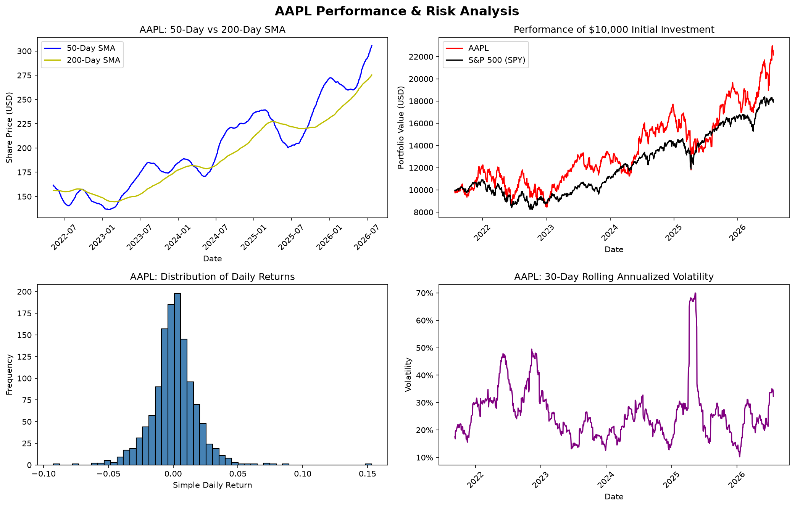

# market-data-explorer

Six small Python scripts for pulling, analyzing, and charting stock market data.



## Scripts

- `01_sp500_census.py` — answers questions about the S&P 500 constituents table and saves a cleaned copy
- `02_leaderboard.py` — pulls live fundamentals for 10 mega-caps and ranks them by market cap
- `03_golden_cross.py` — finds every 50/200-day moving average crossover for a ticker
- `04_array_drills.py` — NumPy slicing, masking, and statistics on 10 years of closes
- `05_growth_of_10k.py` — final value, CAGR, and annualized volatility for four tickers
- `06_dashboard.py` — 2x2 dashboard for any ticker: trend, growth vs SPY, return distribution, rolling volatility

## How to run

```
python -m venv .venv
source .venv/bin/activate
pip install -r requirements.txt
python 06_dashboard.py
```

Run from the repo root — the scripts use relative paths.

## Limitations

- Data comes from yfinance, which scrapes Yahoo Finance; fields occasionally change or come back empty.
- The S&P 500 constituent list is current membership only, so the census reflects the index as it stands today — companies removed over time don't appear.

Educational project — not investment advice.
